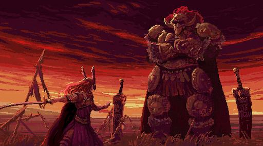
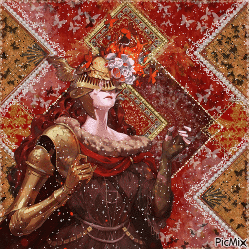
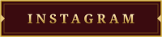
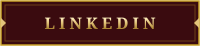
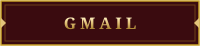

  

  

<table align="center">
<tr>
<td width="45%" align="center" valign="middle">

</td>
<td width="55%" align="center" valign="middle">

&nbsp;&nbsp;

&nbsp;&nbsp;

  

  

  

</td>
</tr>
</table>

  

  <picture>
    <source media="(prefers-color-scheme: dark)" srcset="https://raw.githubusercontent.com/EmanoelLimaGomes/EmanoelLimaGomes/output/scarlet-snake-dark.svg" />
    <source media="(prefers-color-scheme: light)" srcset="https://raw.githubusercontent.com/EmanoelLimaGomes/EmanoelLimaGomes/output/scarlet-snake.svg" />
    
  </picture>

 

  

  
  &nbsp;
  
  &nbsp;
  

 

  

