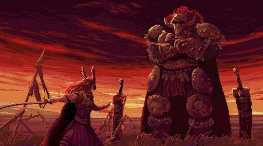
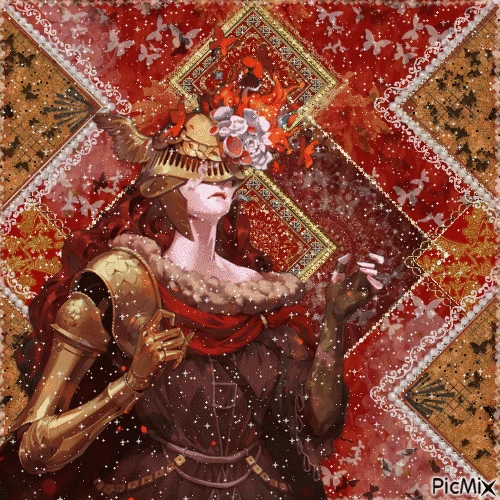

<h3>Salve, eu sou o Emanoel ⚔️</h3>

#### 🛡️ Contributions:

<table>
<tr>
<td width="60%" align="center">

 

⚔ ━━━━━ ✠ ━━━━━ ⚔

  

&nbsp;&nbsp;&nbsp;

&nbsp;&nbsp;&nbsp;

  

  

<picture>
  <source media="(prefers-color-scheme: dark)" srcset="https://raw.githubusercontent.com/EmanoelLimaGomes/EmanoelLimaGomes/output/scarlet-snake-dark.svg" />
  <source media="(prefers-color-scheme: light)" srcset="https://raw.githubusercontent.com/EmanoelLimaGomes/EmanoelLimaGomes/output/scarlet-snake.svg" />
  
</picture>

  

#### ⚒️ Arsenal

  

  

⚔ ━━━━━ ✠ ━━━━━ ⚔

</td>
<td width="40%" align="center">

</td>
</tr>
</table>
